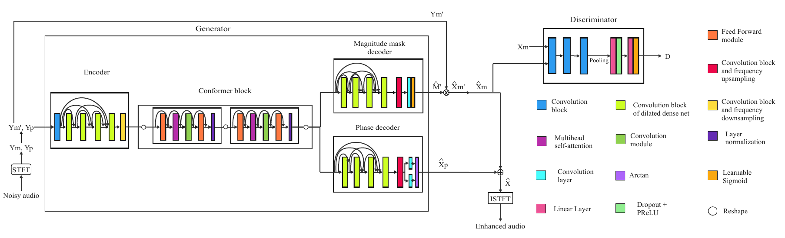

# MiniGAN: Towards an Efficient and Accurate Speech Enhancement by a Comprehensive Ablation Study

Lidia Abad, Fernando López, Jordi Luque. IberSPEECH 2024.
[Paper](https://www.isca-archive.org/iberspeech_2024/abad24_iberspeech.pdf) ·
[Master's thesis](https://cig.fi.upm.es/wp-content/uploads/TFM_LIDIA_ABAD_AZCUTIA.pdf) ·
[Audio demo](https://lidiaabad.github.io/EtsiinfTFM-MiniGAN/)

In recent years, significant advancements in speech enhancement have been made through phase reconstruction, dual-branch methodologies or attention mechanisms. These methods produce exceptional results but at expense of a high computational budget. This work aims to enhance the efficiency of the MP-SENet architecture by introducing MiniGAN, a generative adversarial network in the time-frequency domain. It features an encoder-decoder structure with residual connections, conformers, and parallel signal magnitude and phase processing. We employ data augmentation techniques in training, investigate the impact of various loss terms, and examine architectural alterations to achieve lower operational costs without compromising performance. Our results on the VoiceBank+DEMAND evaluation set report that MiniGAN achieves competitive figures in objective metrics, obtaining a PESQ of 2.95, while maintaining low latency and reducing the computational complexity. The suggested MiniGAN system is ideally suited for real-time applications on resource-constrained devices, as it achieves a real-time factor of 0.24 and has a mere 373k parameters.



## Quick start

Tested with Python 3.12. Evaluating and training also need `ffmpeg` and a C compiler for `pesq`.

```bash
python3 -m venv .venv
source .venv/bin/activate
pip install -r requirements.txt

ffmpeg -i audios/traffic_english/noisy_english_traffic.wav -ar 16000 -ac 1 noisy.wav
python -m scripts.enhance --input noisy.wav --output enhanced.wav
```

Run the commands from the root of the repository. Input audio must be 16 kHz mono, which is why the example
is converted first. CPU is enough for inference.

## Models

`checkpoints/<folder>/` holds `generator.pt` and `discriminator.pt` for every model of the paper. Pass
the folder name as `--variant` to any script.

| Folder | What changes with respect to MiniGAN | Params (M) | PESQ | CSIG | CBAK | COVL | SSNR | STOI |
|---|---|---|---|---|---|---|---|---|
| `MiniGAN` | Reference model, trained with reverberation and BandMask | 0.373 | 2.95 | 4.36 | 3.46 | 3.72 | 7.49 | 0.94 |
| `MiniGAN-FT` | Frequency conformer before the time conformer | 0.373 | 2.93 | 4.36 | 3.52 | 3.71 | 8.43 | 0.94 |
| `MiniGAN-48` | 48 channels instead of 32 | 0.801 | 2.95 | 4.34 | 3.46 | 3.71 | 7.62 | 0.95 |
| `MiniGAN-NDA` | Trained with neither reverberation nor BandMask | 0.373 | 2.96 | 4.31 | 3.43 | 3.70 | 7.06 | 0.94 |
| `MiniGAN-WN` | Also trained with white noise | 0.373 | 2.82 | 4.27 | 3.47 | 3.59 | 8.48 | 0.94 |
| `MiniGAN-ED` | Plain encoder-decoder: five convolution blocks, no dilated dense net, no frequency downsampling | 0.325 | 2.05 | 3.64 | 2.64 | 2.88 | 1.50 | 0.93 |
| `MidGAN` | `MiniGAN-ED` with two conformer blocks (thesis only) | 0.550 | 2.07 | 3.71 | 2.73 | 2.91 | 1.53 | 0.93 |

The metrics are the ones published on the VoiceBank+DEMAND test set: table 1 of the paper, and table 5.1
of the thesis for `MidGAN`. The noisy test set scores PESQ 1.97.

**Two checkpoints do not reproduce their published metrics:** `MiniGAN-NDA` and `MidGAN` score lower on
the test set than reported (see [Reproduced results](#reproduced-results)). The weights behind those
published numbers are not available, so treat these two checkpoints as approximations of their experiments.

The thesis uses other names for some of these models:

| Paper and this repository | Thesis |
|---|---|
| `MiniGAN` | MiniGAN, MiniGAN-DA |
| `MiniGAN-WN` | MiniGAN-DA+WN |
| `MiniGAN-ED` | LitGAN |

`checkpoints/LitGAN/` is kept under that name too, and its files are identical to `MiniGAN-ED`.

Parameter counts include the 25,810 parameters of the discriminator, which is only needed for training.
The MiniGAN generator alone has 347,273 parameters.

| Model | FLOPS (M) | Size (MB) | RTF (CPU) |
|---|---|---|---|
| MP-SENet | 47489 | 8.23 | 1.15 |
| MiniGAN | 9023 | 1.43 | 0.24 |
| MiniGAN-ED | 10958 | 1.25 | 0.56 |

## Data

Download [VoiceBank+DEMAND](https://doi.org/10.7488/ds/2117) and unzip these files into one folder:
`clean_trainset_56spk_wav.zip`, `noisy_trainset_56spk_wav.zip`, `clean_testset_wav.zip`,
`noisy_testset_wav.zip` and `logfiles.zip`. Then run:

```bash
python -m scripts.prepare_data --valentini_dir path/to/valentini --output_dir data
```

This downsamples the audio to 16 kHz with ffmpeg, extracts the training noises as `noisy - clean`, and
holds out 10% of the speakers and of each noise type for validation in `data/partition/`.

## Evaluation

```bash
python -m scripts.evaluate --variant MiniGAN \
    --noisy_dir data/noisy_testset_wav --clean_dir data/clean_testset_wav

python -m scripts.benchmark --variant MiniGAN --noisy_dir data/noisy_testset_wav
```

`scripts/benchmark.py` reports parameters, size, FLOPS and RTF. The RTF depends on your CPU.

Files are enhanced whole, without slicing, and memory grows with the square of their length. The longest
test file, 9.8 s, needs about 10 GB of RAM with MiniGAN and 21 GB with MidGAN on CPU, and does not fit in a
6 GB GPU. When the GPU runs out of memory, the scripts enhance that file on the CPU instead.

### Reproduced results

Running `scripts/evaluate.py` with the checkpoints of this repository on the 824 files of the test set:

| Model | PESQ | CSIG | CBAK | COVL | SSNR | STOI |
|---|---|---|---|---|---|---|
| `MiniGAN` | 2.94 | 4.36 | 3.45 | 3.71 | 7.44 | 0.94 |
| `MiniGAN-FT` | 2.92 | 4.35 | 3.51 | 3.70 | 8.38 | 0.95 |
| `MiniGAN-48` | 2.94 | 4.34 | 3.46 | 3.70 | 7.60 | 0.95 |
| `MiniGAN-NDA` | 2.64 | 3.91 | 3.31 | 3.32 | 7.24 | 0.93 |
| `MiniGAN-WN` | 2.81 | 4.26 | 3.47 | 3.59 | 8.44 | 0.94 |
| `MiniGAN-ED` | 2.08 | 3.65 | 2.64 | 2.89 | 1.46 | 0.93 |
| `MidGAN` | 1.94 | 3.48 | 2.58 | 2.74 | 1.51 | 0.93 |

`scripts/benchmark.py` on 40 test files gave 9000 M FLOPS for `MiniGAN`, 10930 M for `MiniGAN-ED` and
18784 M for `MidGAN`. The RTF on an Intel Core i7-11850H laptop CPU was 0.33, 0.73 and 1.46 respectively.

## Training

```bash
python -m scripts.train --variant MiniGAN --partition_dir data/partition
```

`--variant` selects the architecture and the augmentation of the table above. The defaults are the
settings of the paper, for every variant:

| Setting | Value |
|---|---|
| Epochs, patience | 120, 75 |
| Batch size, gradient accumulation | 1, 16 |
| Optimizer | AdamW, initial learning rate 0.001, halved every 30 epochs |
| Window, background noise SNR | 2 s, 5 to 30 dB |
| STFT | 512 points, hop 100, Hamming window, compression 0.3 |
| Loss weights | magnitude 0.2, phase 0.2, group delay 0.1, angular frequency 0.1, time 0.1, GAN 0.05 |

`MiniGAN-WN` was unstable, so as in the paper it also uses a generator learning rate of 0.0005, Kaiming
initialization and gradient clipping at 0.5.

Training writes to `runs/<variant>/`: `generator.pt` and `discriminator.pt` are the best on validation,
`*_last.pt` are from the last epoch, and `history.json` holds the losses. The paper's models took about
four days on a GeForce GTX 1080 Ti.

## Audio examples

`audios/` holds the examples recorded for this work by the authors: the same speaker in English and in
Spanish, with instrumental music, lyrical music or traffic as background noise. Each folder has the noisy
recording (`noisy_*`) and its enhanced versions by MiniGAN, MidGAN and LitGAN (`MiniGAN-ED`). The files are
at 8 kHz. The models were trained only on English speech at 16 kHz. Music is harder to clean than traffic,
and lyrical music the hardest, because the noise itself contains speech.

## Tests

```bash
pip install pytest
python -m pytest tests
```

The tests check that every checkpoint loads and matches the published parameter counts.

## Citation

```bibtex
@inproceedings{abad2024minigan,
  title     = {Towards an Efficient and Accurate Speech Enhancement by a Comprehensive Ablation Study},
  author    = {Abad, Lidia and L{\'o}pez, Fernando and Luque, Jordi},
  booktitle = {Proc. IberSPEECH 2024},
  pages     = {101--105},
  year      = {2024},
  doi       = {10.21437/IberSPEECH.2024-21}
}
```

## License

Released under [CC BY-NC 4.0](LICENSE). The code builds on MP-SENet, CMGAN and Denoiser; see
[THIRD_PARTY_NOTICES.md](THIRD_PARTY_NOTICES.md).

VoiceBank+DEMAND is not included in this repository. Download it from its
[original source](https://doi.org/10.7488/ds/2117).
